# LightLauncher

[](LICENSE)
[](https://github.com/icarloscornejo/LightLauncher/releases/latest)

A light, tvOS style home screen for Android TV and Google TV. A glass dock, a top shelf that shows what your
apps want to play next, a photo screensaver and a settings screen you can drive with the remote. Plain Android
Views in Kotlin, no analytics, no accounts.

[Leer en español](README.es.md)

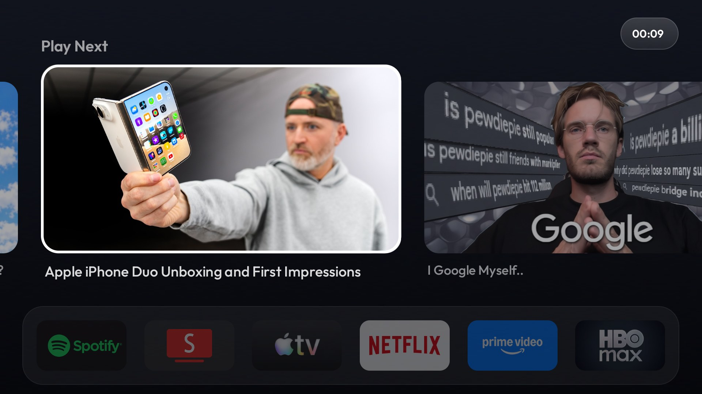

## What it does

- **A dock and an app grid.** Your favourites (six by default, set in `config.xml` or a theme) on a translucent
  glass panel, where a favourite that is not installed leaves its slot empty, and every other app below. The focused tile zooms and lifts with a shadow.
- **A top shelf** (off by default). The focused dock app shows what it publishes to the TV: full screen pictures
  that cross-fade slowly, or a row of "Play Next" cards. The focused card grows and pushes its neighbours aside,
  like the Netflix home, and each app remembers the card you were on.

  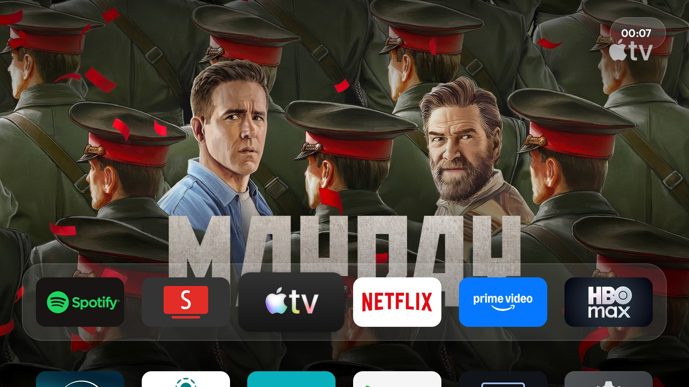

- **A blurred backdrop.** Go down from a dock app to the grid and the picture of its shelf stays behind the
  apps, blurred and tinted for the theme.

  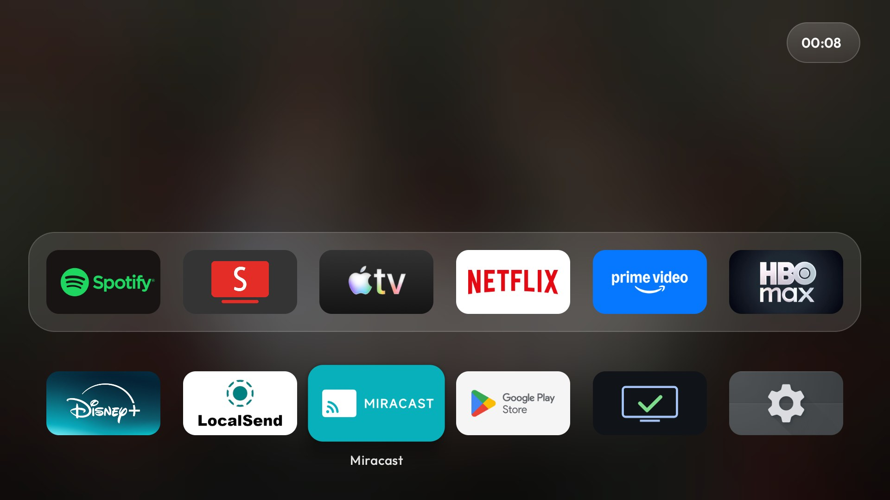
  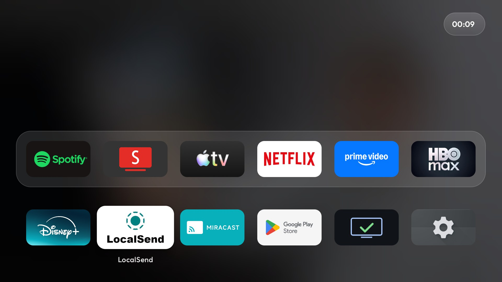

- **Light and dark.** Pale, soft backgrounds or dark ones, chosen in the settings.

  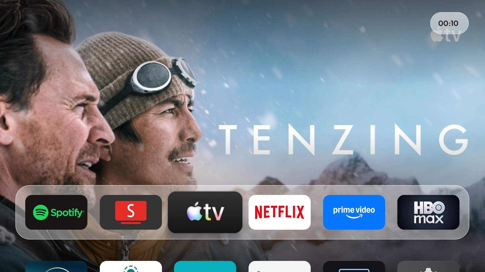
  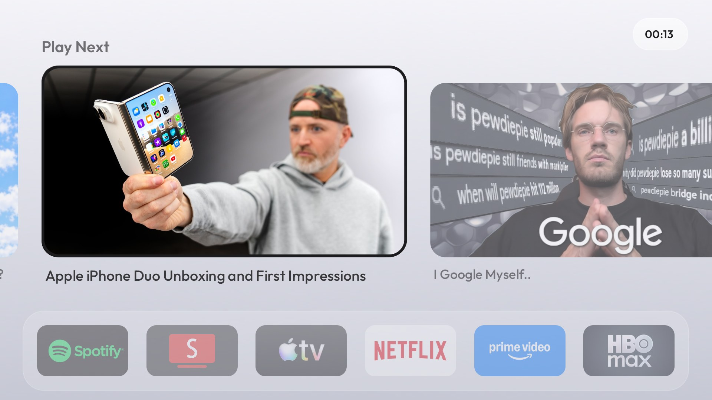
  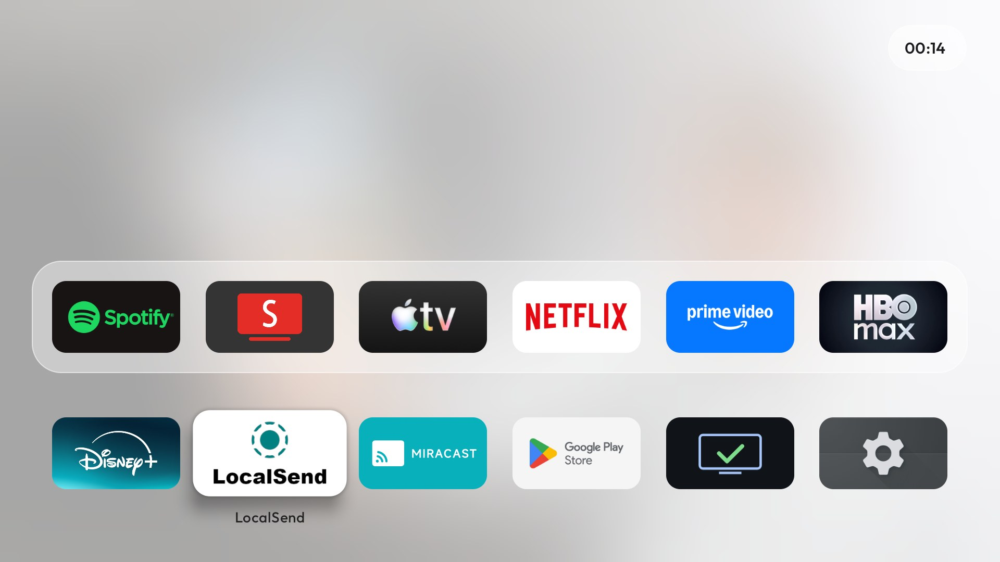
  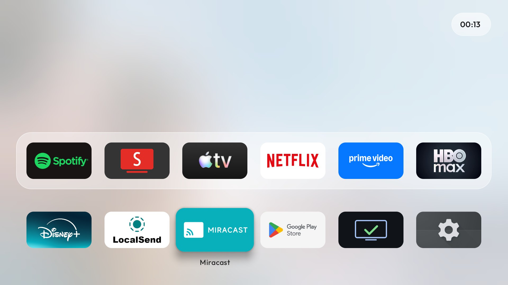

- **Arrange the apps from the TV.** Long press an app to move it: Left and Right trade places in the dock,
  Down trades with the app below, and in the grid the others slide along. Every step is saved.

  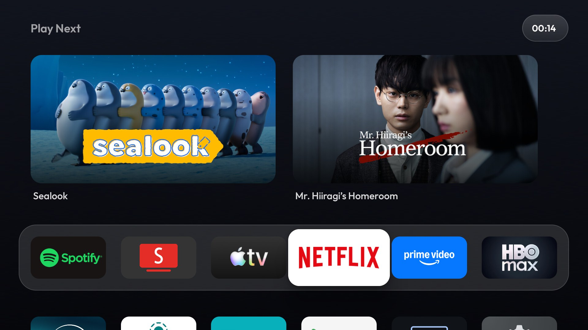
- **Settings like the tvOS list.** Inputs (HDMI, AV, Live TV), Wi-Fi, TV settings and the launcher's own page.

  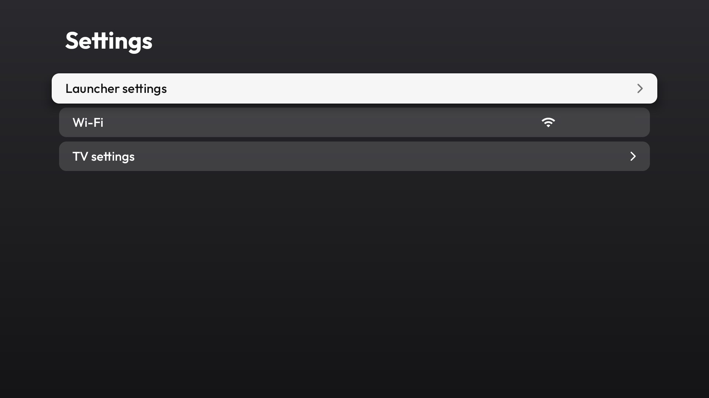 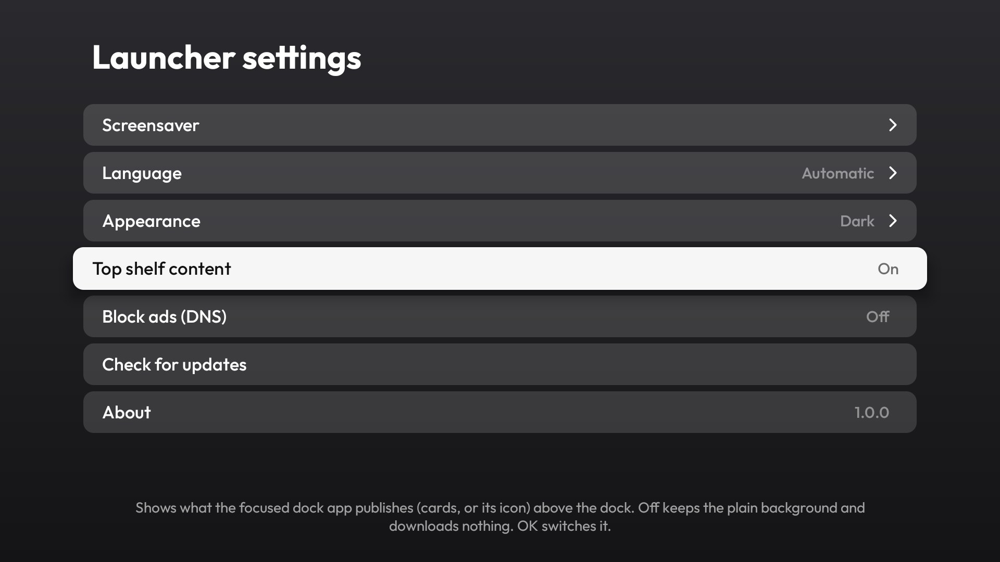

- **A photo screensaver** from a shared Google Photos album, or a clock without one.
- **Themes** pushed over ADB (`config.json` and an optional wallpaper).
- English and Spanish, chosen in the settings or following the TV.

## Requirements

Android TV or Google TV 8.0 (API 26) or newer, with network debugging (ADB) turned on in the developer options.
Tested on a Sony BRAVIA (Google TV, Android 12) and a Xiaomi TV box (Google TV, Android 14).

## Install

### From a release

Download `LightLauncher-<version>.apk` from the [releases](https://github.com/icarloscornejo/LightLauncher/releases/latest),
then, with `<tv-ip>` the address shown in the TV's network settings:

```sh
adb connect <tv-ip>:5555
adb install LightLauncher-1.0.0.apk
adb shell pm grant com.prototype.lightlauncher android.permission.READ_TV_LISTINGS
adb shell pm grant com.prototype.lightlauncher android.permission.WRITE_SECURE_SETTINGS
adb shell pm grant com.prototype.lightlauncher android.permission.ACCESS_FINE_LOCATION
adb shell appops set com.prototype.lightlauncher REQUEST_INSTALL_PACKAGES allow
adb shell cmd package set-home-activity --user 0 com.prototype.lightlauncher/.MainActivity
```

What each one is for: `READ_TV_LISTINGS` lets the top shelf read what apps publish; `WRITE_SECURE_SETTINGS` lets
the launcher keep animations at their normal speed on TVs that reset them and switch the ad-blocking DNS;
`ACCESS_FINE_LOCATION` is what Android asks for before an app may read the Wi-Fi name; the last two let the
launcher install its own updates and make it the Home app. None of them is required to use the launcher, each only
turns one feature on.

On Google TV the Home button may still open Google's launcher. Disable it (you can enable it again at any time):

```sh
adb shell pm disable-user --user 0 com.google.android.apps.tv.launcherx     # or com.google.android.tvlauncher
adb shell pm disable-user --user 0 com.google.android.tungsten.setupwraith   # the setup wizard, if it also claims Home
```

Disable the old launcher only after this one is installed and set as Home, or the Home button has nothing to open.

### From source

Requirements: JDK 17, the Android SDK (platform 37) and Python 3 for the helper scripts.

```sh
python3 -m venv tools/venv && tools/venv/bin/pip install -r tools/requirements.txt
cd launcher
TV_HOST=<tv-ip> ./build-and-install.sh
```

The script builds the release APK, installs it, grants the permissions above, makes it the Home app and turns the
stock launcher off (`STOCK_LAUNCHER=none` skips that when it is already off). On Windows use
`launcher\build-and-install.ps1 -TvHost <tv-ip>`. Unit tests: `./gradlew test`.

## First run

The top shelf starts **off**: while it is off the launcher reads nothing from the TV and downloads nothing. Turn it
on in the clock pill (top right), Launcher settings, Top shelf content.

Two optional accessibility services help remotes with unusual buttons. Both are off until you turn them on
(re-pass them on every install of the script, or run the commands yourself):

```sh
# HomeKeyService: remotes whose Home button sends "All apps" (Xiaomi sticks). InputKeyService: the Input button
# opens the input switcher. Use one, or both separated by a colon.
adb shell settings put secure enabled_accessibility_services com.prototype.lightlauncher/.HomeKeyService:com.prototype.lightlauncher/.InputKeyService
adb shell settings put secure accessibility_enabled 1
```

## Settings

Press the clock pill (Up from the dock, or Up again from the cards).

| Row | What it does |
|---|---|
| Inputs | HDMI, AV and Live TV, when the TV lists them |
| Launcher settings | The launcher's own page, below |
| Wi-Fi | The network name; OK opens the VPN app if one is set, otherwise the Wi-Fi settings; hold OK for the Wi-Fi settings |
| TV settings | The system settings |

| Launcher settings | What it does |
|---|---|
| Screensaver | Preview it, pick LightLauncher as the screensaver and set the photo album |
| Language | Automatic, English or Spanish |
| Appearance | Light or Dark |
| Top shelf content | Show what the focused dock app publishes above the dock (off by default) |
| Block ads (DNS) | Turns on Private DNS through AdGuard, which blocks ads and trackers in other apps (not YouTube's) |
| Check for updates | Looks for a newer release on GitHub, see below |
| About | The version and where the code lives |

## Photo screensaver

Choose LightLauncher as the screensaver in Launcher settings, Screensaver. To show photos, open Photo album, Album
link: the TV shows a QR code, you scan it with your phone and paste the link of a shared Google Photos album. The
TV serves one small page on your local network for that moment (random token, one link, five minutes at most).

You can also set the link in a theme, see [themes/README.md](themes/README.md):

```json
{ "dream_album_url": "https://photos.app.goo.gl/..." }
```

Anyone who has a shared album link can open the album, so keep yours out of public repos. The photos are
downloaded at most once a day, over https only, from Google Photos hosts only; 16:9 photos are shown alone and
narrower ones in pairs, with no repeats until every photo was shown.

## Updates

Launcher settings, Check for updates looks for a newer release of this repository, downloads its APK, checks it
against the SHA-256 that GitHub publishes for it and hands it to Android's installer, which asks you to confirm.
Android only installs an update over an app signed with the same key, so this works for releases from this
repository; if you built the launcher yourself, build the next version yourself too. Accessibility services that
were on are turned on again by the new version; if Android does not let it, a message says so and the commands
above bring them back.

## Privacy

No analytics, no accounts, nothing is sent about you. The launcher uses the network in three places, all opt-in or
on demand, each with fixed rules written down in [docs/DEVELOPMENT.md](docs/DEVELOPMENT.md):

- the screensaver album (https, Google Photos hosts only),
- the top shelf pictures (https, only for the dock apps, with size and time limits), and
- the update check (https, GitHub hosts only), when you ask for it.

Block ads (DNS) changes the system's Private DNS to AdGuard's, so the TV's DNS lookups then go to AdGuard.

## Project

- [docs/DEVELOPMENT.md](docs/DEVELOPMENT.md): architecture, the network rules, testing on a TV, releasing.
- [themes/README.md](themes/README.md): the `config.json` keys and how to push a theme.
- [CHANGELOG.md](CHANGELOG.md) and [SECURITY.md](SECURITY.md).

Contributions are welcome: keep the layers described in the development notes (`DependencyRulesTest` enforces them),
add a JVM test next to any new logic in `core`, and run `./gradlew test` before opening a pull request.

## License

[MIT](LICENSE). Credits and third-party notices, including the Outfit typeface, are in
[THIRD_PARTY_NOTICES.md](THIRD_PARTY_NOTICES.md).

Netflix, Spotify, Apple TV, Prime Video, Max and the other apps and pictures in the screenshots belong to their
owners; they appear only because they are installed on the TV the screenshots were taken on.
